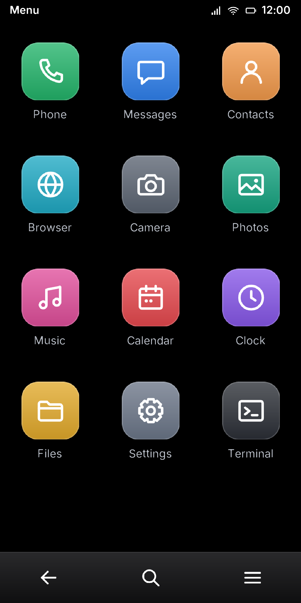
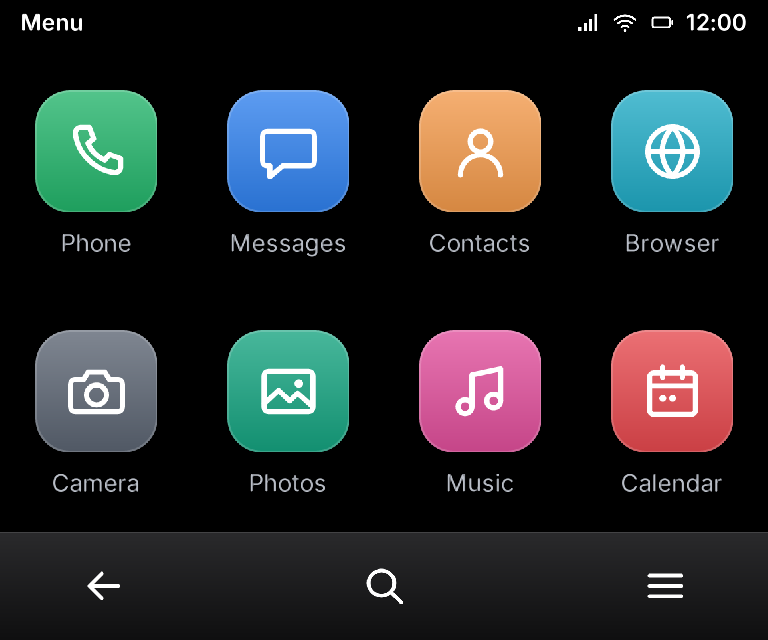

# neoui

neoui is the Rust touch UI server for NeoSymbian. It will run on the 32-bit ARM
Symbian user side (`no_std` + `alloc`) and draw into a raw framebuffer, first
under QEMU Syborg (768x640), later on a Pixel 3a XL (1080x2160).

This first step proves the rendering path: a phone launcher written in Slint,
rendered by Slint's **software renderer** into a caller-owned `&mut [u32]`
XRGB8888 buffer. That is the same path the Symbian framebuffer will use; on the
Mac the buffer is just shown in a window.

| Pixel 3a XL, 1080x2160 | QEMU Syborg, 768x640 |
| --- | --- |
|  |  |

(`snapshots/launcher-*-tapped.png` show the frame after tapping Messages.)

## Layout

| Path | What |
| --- | --- |
| `crates/neoui-proto` | `#![no_std]` shared types: `Rect`, `Damage`, `InputEvent`, `SurfaceId` |
| `crates/neoui-render` | `#![no_std]` + `alloc`: Slint platform on `MinimalSoftwareWindow`; `Renderer::new(w, h, now_ms)`, `render(buf, stride) -> Damage`, `dispatch(InputEvent)` |
| `ui/launcher.slint` | The launcher: status bar, banner, 8 app tiles; sizes follow the window |
| `ui/fonts/` | Inter (OFL-1.1), bundled so the glyphs baked into the binary do not depend on the build host's fonts |
| `crates/neoui-host` | Mac/Linux desktop host: winit + softbuffer, mouse as touch |
| `snapshots/` | PNGs written by the snapshot tests |
| `crates/neoui-term` | `#![no_std]` text console model: the grid, cursor and control characters of a Symbian console window |
| `crates/neoui-proto` `ipc` | The app ↔ UI server protocol: `GEOMETRY`, `SURFACE`, `DAMAGE`, `NEXT_EVENT`, 16-byte events |
| `symbian/` | The launcher as a Symbian EXE (`SYSSTART.EXE`, GPL-3.0): its own workspace, built for `armv5te-none-eabi` with [e32-rs](https://github.com/NeoSymbian/e32-rs) |

The renderer takes its time from a caller-supplied millisecond clock and owns
no thread, file or OS handle. Glyphs are rendered to signed distance fields at
build time (`slint-build` `sdf-fonts`), so text scales to any size without font
files on the target.

Limits of this step: one `Renderer` per process (Slint's platform is a
process-wide singleton and is built with `unsafe-single-threaded`), a single
pointer (all touch ids drive it), a static clock text, and no app launching yet.

## Run

```sh
cargo run -p neoui-host -- --size pixel    # 1080x2160 framebuffer shown at 50%
cargo run -p neoui-host -- --size syborg   # 768x640
```

Click a tile: the banner shows its name and the tile gets a halo.

## Test

```sh
cargo fmt --check
cargo clippy --all-targets -- -D warnings
cargo test                     # unit tests + snapshots/launcher-*.png
rustup target add thumbv7em-none-eabihf
cargo build -p neoui-proto -p neoui-render --target thumbv7em-none-eabihf   # no_std check
```

The snapshot tests render both sizes, check the frame is not blank, tap the
Messages tile and check that pixels change and that every changed pixel lies
inside the reported damage.

## On Symbian (QEMU Syborg)

`symbian/` runs the launcher on the 2010 Symbian user side **instead of the window server**: estart starts
`SYSSTART.EXE` when the ROM has one. It reads the frame buffer from the HAL, registers as the window server to take
raw pointer and key events from the kernel, renders into a RAM frame and copies the damaged rectangles to the screen.
On Syborg the first frame takes about 80 ms, and tapping the Phone tile opens the Phone screen.

```sh
cd symbian && cargo arm        # target/armv5te-none-eabi/release/libneoui_symbian.a (nightly pinned here)
# with NeoSymbian/build: copy the .a and exes.txt into its rust/, then
./build.sh && MONITOR="mouse_move 3243 27904;mouse_button 1;mouse_button 0" ./boot.sh   # out/fb.png, out/serial.log
```

**Apps are separate processes (R6).** The UI server is also the `NeoUi` IPC server (protocol in
`neoui-proto::ipc`). When the shell navigates to an app that exists as an EXE (so far `clock` → `NEOCLOCK.EXE`,
`symbian/apps/clock`), the server starts it through the Symbian loader. The app connects, receives its drawing
surface (a global chunk shared by handle, mapped at the same address in both processes), renders its own Slint UI
into it and reports damage. The server shows the surface in the shell's body, between the live status bar and
toolbar. Touches in the body go to the app; Back makes the server send `Quit`, and the app exits.

**A Terminal app (R6b): ESHELL and the 2010 text programs inside the Rust UI.** `NEOTERM.EXE`
(`symbian/apps/term`) is the Symbian text console server `!E32WindowServer`; the UI ROM ships the stock
`econs.dll` (a client of that server) as `ECONS.DLL`, so `Console::NewL` in ESHELL and in any text program lands in
our terminal. The grid (`crates/neoui-term`, host-tested) follows the stock console's rules: newline mode, wrap,
destructive backspace, tabs, scrolling. Keys come from the keyboard and from the extra-keys bar. `dir` and
`neotest` run in it on Syborg. Apps share their plumbing (connect, surface, Slint platform) in `symbian/neoapp`.

The UI adapts to whatever the device reports: the display size comes from the HAL, touches are raw screen pixels
(Syborg's pointer driver was fixed in the NeoSymbian adaptation fork to report exact pixels), and the layout follows
the design's `dp` unit. The `syborg` CI job runs a phone-shaped, odd-sized screen (539x1079, half the Pixel's
1079x2159 touch range): it opens the Apps menu, opens Clock, taps it and goes back (`symbian/taps.sh` builds the
QEMU monitor script for any `SCREEN`), and checks the serial log and the screen. It publishes the screenshot and the
log, never the ROM (see the licence note below).

## Licence

Apache-2.0, see `LICENSE`. Dependencies carry their own licences, notably:

- **Slint** is GPL-3.0-only, or the Slint Royalty-free Desktop/Mobile/Web
  licence, or a commercial licence. The royalty-free licence excludes embedded
  systems and applications that expose Slint's APIs. A launcher/UI server that
  is part of a phone OS may fall outside it, so decide the Slint licence before
  shipping neoui in a NeoSymbian image. For now (2026-11-06) the Symbian EXE in `symbian/` uses Slint under
  GPL-3.0 and is itself GPL-3.0; ROM images that contain it are not distributed.
- **Inter** font (`ui/fonts/`): OFL-1.1-RFN.
